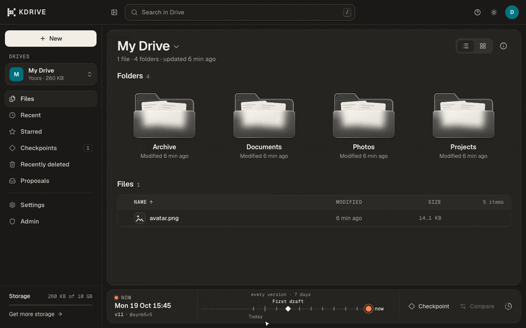
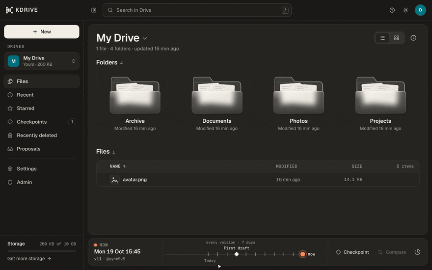
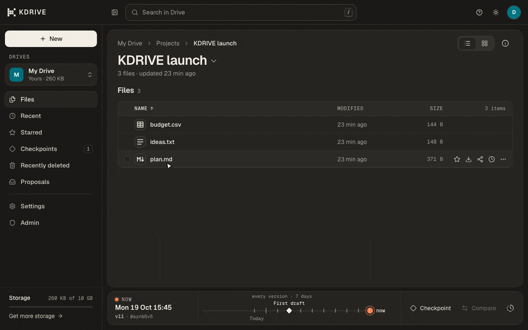
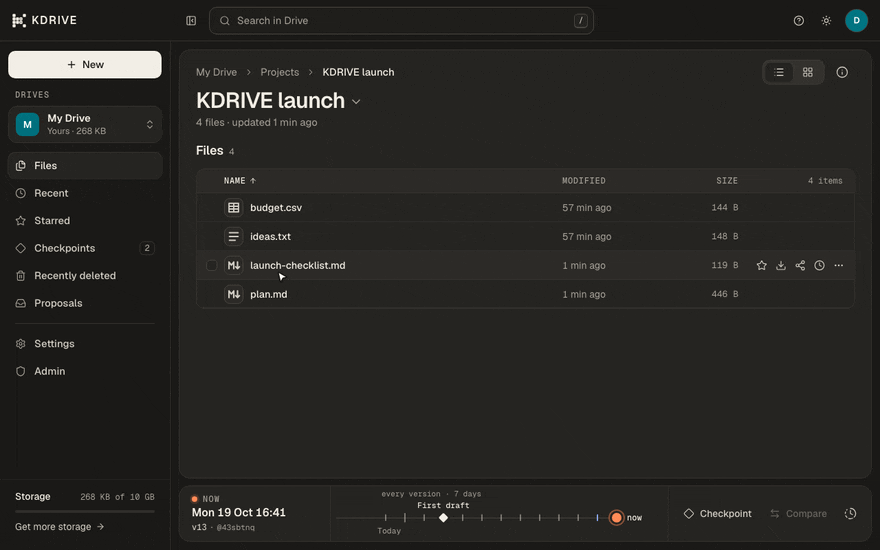
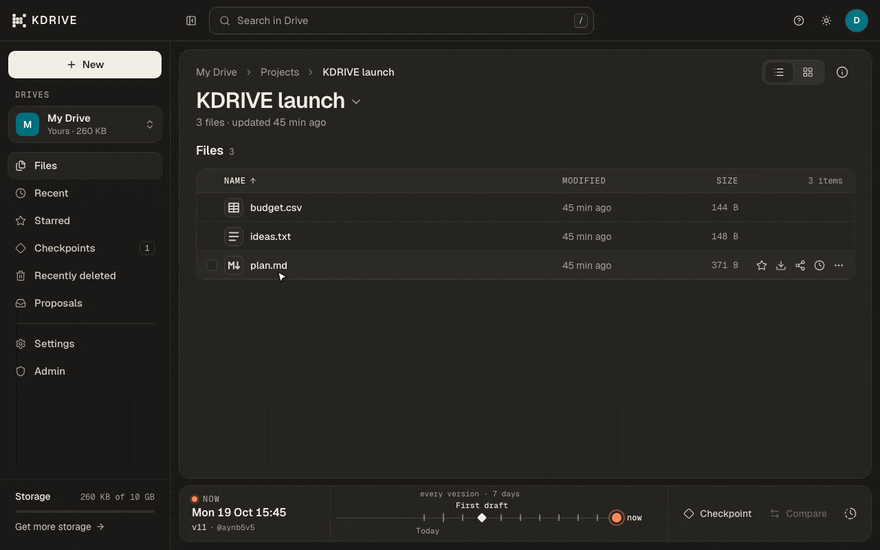
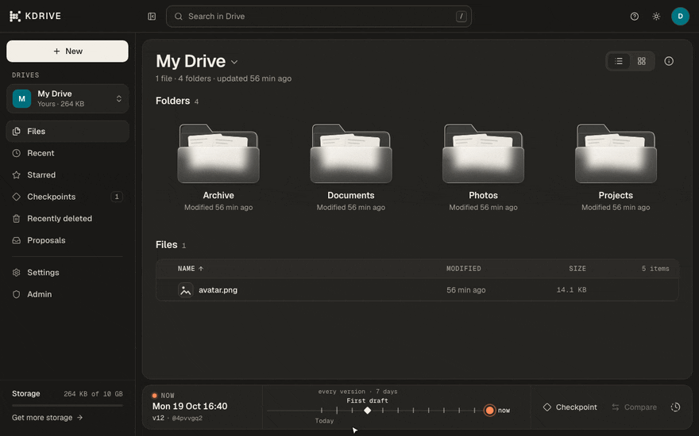

<p align="center">
  <a href="https://kdrive.platinum.dev"></a>
</p>

<p align="center">
  
</p>

# KDRIVE

The drive that remembers. A cloud drive where **every change is a version**:
go back to any point, compare two versions of a file or of the whole drive,
restore a file, a folder or everything, and undo it all.

**Live at [kdrive.platinum.dev](https://kdrive.platinum.dev)**, 10 GB free.

[Try it](https://kdrive.platinum.dev) · [Features](#features) · [How it works](#how-it-works) · [AI agents](docs/ai-agents.md) · [Self-hosting](docs/self-hosting.md) · [Develop](#develop)

- **Every change is a version.** An upload of 200 files or a move of 3 items
  is one version. Scrub the timeline, see the drive as it was, restore as a
  new version (so a restore can be undone too).
- **Share by link.** Live (follows the item through renames and moves) or
  pinned to one version, with expiry, passwords and specific people.
- **Built for AI agents.** KDRIVE is an MCP server. By default agents propose
  and you review; every change they make is attributed and undoable.

## Features

<table>
  <tr>
    <td width="50%"><b>Drive</b><br>Folders, list and grid views, previews for images, Markdown, code, CSV, PDF and audio, with every action one keystroke away.<br><br></td>
    <td width="50%"><b>Time travel</b><br>The timeline at the bottom is the whole drive's history. Click any point to see the drive as it was, read-only, then go back to now.<br><br></td>
  </tr>
  <tr>
    <td width="50%"><b>Versions and compare</b><br>Every kept version of a file, across renames. Compare any two side by side, line by line, and restore either one.<br><br></td>
    <td width="50%"><b>Share links</b><br>Live or pinned to a version, with expiry, a password or specific people. Viewers need no account.<br><br></td>
  </tr>
  <tr>
    <td width="50%"><b>AI agents, reviewed</b><br>Agents connect over MCP. Their changes wait under Proposals: compare each file, then accept or discard all of it, or one file at a time.<br><br></td>
    <td width="50%"><b>Recover and keep</b><br>Restore anything from Recently deleted. Name a version as a checkpoint and it is kept until you remove it.<br><br></td>
  </tr>
</table>

Also: an admin console with users, drives, storage requests, billing and an
audit log ([self-hosting](docs/self-hosting.md#admins)); shared drives with
editors and viewers; comments and tags on files; Stripe billing for Plus
(100 GB) and Pro (1 TB).

<p align="center">
  
</p>

## Connect an agent

```bash
your-agent mcp add --transport http kdrive https://kdrive.platinum.dev/mcp
```

The agent signs in with OAuth (or an agent token) and you choose what it may
do: read only, suggest changes for your review, or change files directly.
[docs/ai-agents.md](docs/ai-agents.md) covers sign-in, access levels, review
mode and the tools.

## How it works

| | |
|---|---|
| **Workspace** | A drive of files and folders ("My Drive"); one person can have several. Backed by one Platinum volume. |
| **Version** | The whole drive as it was after one action. |
| **Checkpoint** | A named version kept until you remove it. |
| **Restore** | Puts a file, a folder or the whole drive back to a version, as a new version. |
| **Share link** | A revocable URL to a file or folder: live or pinned to one version. Optional expiry. |

- **Storage.** Files and versions live in Platinum volumes; uploads go up in
  blocks and identical content is stored once. An on-disk emulator of the
  same semantics stands in for local development and tests.
- **Retention.** Every version from the last 7 days, the newest 50 always,
  and checkpoints and pinned links until you remove them.
- **Stack.** Bun workspaces: `apps/api` (Bun, Hono, Drizzle, better-auth,
  Postgres), `apps/web` (Next.js 16, React 19, Tailwind v4) and
  `packages/shared` (zod contracts and helpers).

## Develop

Needs [Bun](https://bun.sh) 1.3+ and PostgreSQL 15+ on localhost (the current
OS user, no password).

```bash
git clone https://github.com/kortix-ai/kdrive.git && cd kdrive
bun install
bash scripts/install-git-hooks.sh   # pre-commit hygiene check

createdb volumes_dev && createdb volumes_test
cp .env.example apps/api/.env       # BETTER_AUTH_SECRET, VOLUMES_STORAGE=emulated, VOLUMES_DEV_LOGIN=1

bun run db:migrate
bun run seed                        # optional demo drive for dev@volumes.local
bun run dev                         # http://localhost:4100/signin → "Continue with dev account"
```

```bash
bun run typecheck      # shared, api, web
bun run test           # unit + API tests (volumes_test and the emulator)
bun run build          # typecheck + production build of the web app
bun run db:generate    # after changing apps/api/src/db/schema.ts (never db:push)
```

Storage modes, sign-in, admins, email, billing and production are in
[docs/self-hosting.md](docs/self-hosting.md); tests, demo data and a manual
walk-through in [TESTING.md](TESTING.md).

| Path | What |
|---|---|
| `apps/api/` | API, MCP server, storage drivers, migrations |
| `apps/web/` | Drive, admin console and landing page |
| `packages/shared/` | Contracts, plans and helpers shared by both |
| `docs/` | AI agents, Google sign-in, self-hosting |
| `scripts/` | Git hooks and the repo hygiene check |

`.env` files, secrets, `node_modules`, build output and AI assistant files are
never committed: `.gitignore`, a pre-commit hook and CI all check
(`bash scripts/check-repo-hygiene.sh`).
